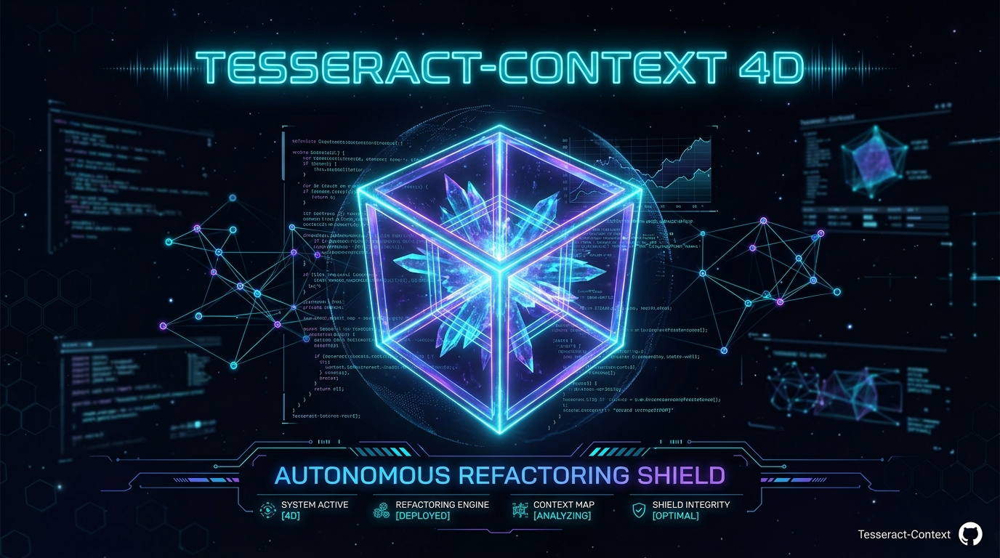
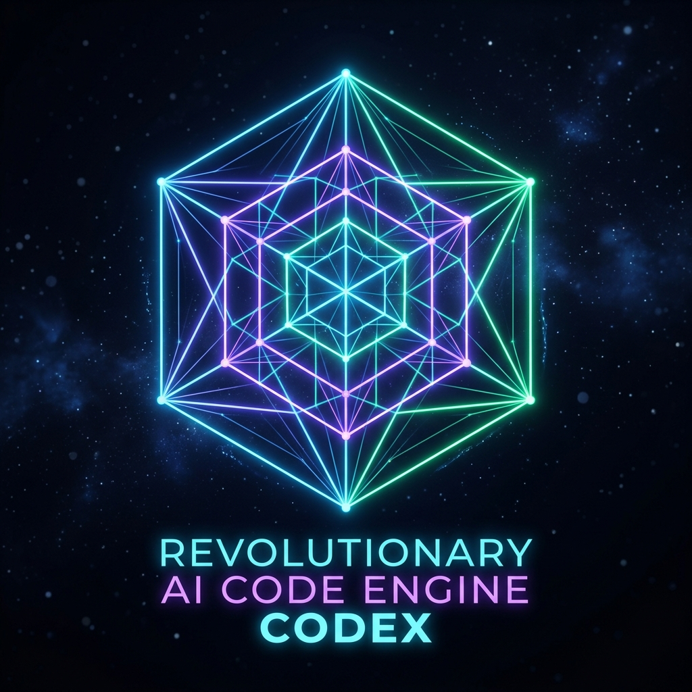

<p align="center">
  
</p>

<p align="center">
  
</p>

<h1 align="center">💎 TESSERACT-CONTEXT (4D)</h1>

<p align="center">
  <strong>The World's First 4D Hypercube Context Engine & Autonomous Refactoring Shield for AI Coding Agents</strong>
</p>

<p align="center">
  <a href="https://github.com/miguelguerra200022-sudo/tesseract-context/actions"></a>
  <a href="https://nodejs.org"></a>
  <a href="https://modelcontextprotocol.io"></a>
  <a href="LICENSE.md"></a>
  <a href="#benchmarks"></a>
</p>

---

## ⚡ Executive Summary

**Tesseract-Context** solves the single most destructive problem in modern AI-assisted software development: the **"Hydra Bug Loop"** (an AI attempts to fix a bug, blindly touches code, and inadvertently creates 2 to 5 silent regressions across distant modules).

Instead of treating codebases as flat text streams or burning millions of tokens with probabilistic vector embeddings, Tesseract maps repositories into an **orthogonal 4-dimensional hypercube ($\mathbb{R}^4$)** structured by a 16-ary fractal **Hexadec-Tree**.

With **In-Memory Transactional Healing**, AI agents (Cursor, Claude Code, Windsurf, VS Code, Antigravity) test refactorings inside an ephemeral RAM clone in $< 2\text{ ms}$ at **0 LLM tokens**. If a proposed change introduces even a single regression, Tesseract executes an **automatic rollback in RAM**, leaving the physical disk 100% protected.

---

## 💥 The Problem: Why Current AI Coding Agents Fail at Scale

1. **Context Rot & Token Exhaustion:** Feeding whole files or blind `grep` outputs into LLM windows burns hundreds of thousands of tokens per query, leading to context truncation, lost architectural memory, and high cloud costs.
2. **The Hydra Bug Loop:** AI models lack global structural visibility. When an agent modifies an export or class signature, it cannot compute downstream ripple effects across 20,000 files.
3. **Passive Tooling:** Standard MCP servers only answer read queries. When the AI writes, it uses blind file-write tools that overwrite code without calculating topological shear distance or broken contracts.

---

## 🏛️ Core Architectural Breakthroughs

```
                      [ 4D Hypercube Space: ℝ⁴ ]
                 W: Temporal Stability / Git History
                                  ▲
                                  │   Z: Architecture Layer (Core..UI)
                                  │  /
                                  │ /
  X: Structural Abstraction ◄─────┼─────► Y: Dependency Density
                                 /│
                                / │
                               ▼  ▼
       [ Hexadec-Tree (16-ary Fractal Spatial Partitioning) ]
                                  │
     ┌────────────────────────────┼────────────────────────────┐
     ▼                            ▼                            ▼
[ 0-Token Static Audit ]  [ Infinite Taint Wave ]  [ In-Memory Sandboxing ]
 20,000+ files scanned      Unbounded ripple-effect   Ephemeral RAM clone (<2ms)
 Deterministic in RAM       Terminal sink detection   Auto-Rollback on regression
```

### 1. In-Memory Transactional Healing (`tesseract_trial_heal`)
- **Zero-Disk Risk:** Clones the hypercube graph in RAM in $< 2\text{ ms}$.
- **Delta Remapping:** Injects the proposed modification, re-parses symbols, and re-audits the delta graph in $O(V + E)$ at **0 LLM tokens**.
- **Automated Rollback:** Evaluates Extinguished Fractures vs. New Regressions. If regressions $> 0$, the RAM transaction is discarded (`BLOQUEADO_POR_REGRESIONES`), generating a rich causal dossier for the AI.

### 2. Infinite Taint Wave & Terminal Sinks (`tesseract_blast_radius`)
- **Unbounded Relational Traversal:** Replaces naive fixed 3-hop approximations. The wave travels through the entire graph until all downstream modules terminate.
- **Physical Disk Verification:** Validates whether each dependent module *actually invokes* the mutated symbol, retrieving verbatim code snippets and exact line numbers.
- **Terminal Sinks:** Identifies boundary endpoints with `outDegree = 0`, delineating the exact stopping boundary of the ripple effect.

### 3. Active 5-Layer Write Shield (`tesseract_safe_write`)
1. **Virtual 4D Shadow Projection:** Calculates topological shear distance ($D_{\text{shear}} \le 0.10$).
2. **Deterministic Contract Assertion:** Verifies call sites across callers and consumers.
3. **Shannon Entropy Gate:** Flags high-entropy strings and secret leakage ($H \ge 4.5$).
4. **Strict Entropy Reduction:** Rejects writes where `NewBrokenContracts > 0`.
5. **Circuit Breaker:** Freezes files after 2 consecutive failed attempts to halt infinite prompt loops.

---

## 💻 CLI Command Reference

Tesseract includes a complete, high-performance command-line suite:

| Command | Syntax | Description | Token Cost |
| :--- | :--- | :--- | :--- |
| **`audit`** | `tesseract audit [dir]` | Deterministic static audit of broken imports, contract mismatches, cycles, and orphan nodes. | **0 tokens** |
| **`trial`** | `tesseract trial <dir> <file> "<code>"` | **Counterfactual in-RAM trial:** Tests proposed code in RAM, maps delta fractures, and triggers auto-rollback if regressions appear. | **0 tokens** |
| **`autoheal`** | `tesseract autoheal <dir> <id> [--commit]` | **Autonomous Mini-Subagent:** Synthesizes a backward-compatible patch, trials it in RAM, and commits only if safe. | **0 tokens** |
| **`blast`** | `tesseract blast <dir> <file> [sym] [hops]` | Calculates the Infinite Taint Wave and blast radius with physical disk verification and terminal sinks. | **< 300 tokens** |
| **`patch`** | `tesseract patch <dir> <file> [sym]` | Synthesizes a zero-touch retrocompatible stub or interface adapter. | **0 tokens** |
| **`flow`** | `tesseract flow <dir> "<query>"` | Geodesic architecture tracing in $\mathbb{R}^4$ from natural language to exact line numbers. | **< 500 tokens** |
| **`hybrid-audit`** | `tesseract hybrid-audit [dir]` | Collaborative triage: pre-filters 99.9% of files in $\mathbb{R}^4$ and outputs critical semantic triage items for AI review. | **< 750 tokens** |
| **`safe-write`** | `tesseract safe-write <dir> <file> "<code>"` | Modifies file on disk **only** if it passes the 5-layer 4D shield. | **0 tokens** |
| **`init`** | `tesseract init [dir]` | Zero-touch autonomous onboarding. Generates `AGENTS.md`, `.cursorrules`, `.mcp.json`, and initial health report. | **0 tokens** |
| **`slice`** | `tesseract slice [dir] [cell]` | Extracts a surgical hyperdimensional slice bounded by strict token budgets. | **Budget-bounded** |
| **`mcp`** | `tesseract mcp [dir]` | Starts the standard JSON-RPC 2.0 Model Context Protocol server over stdio. | **N/A** |
| **`ui`** | `tesseract ui [dir] [port]` | Launches the interactive touch 4D visual dashboard on `localhost:4444`. | **N/A** |

---

## 🔌 Model Context Protocol (MCP) Tools

When connected to Cursor, Claude Code, Windsurf, or VS Code, Tesseract equips agents with these native tools:

| MCP Tool Name | Parameters | Agent Capability |
| :--- | :--- | :--- |
| **`tesseract_trial_heal`** | `targetPath`, `proposedContent` | Simulates a patch in ephemeral RAM. Returns health score delta, extinguished fractures, and regression alerts with rollback confirmation. |
| **`tesseract_auto_heal`** | `fractureId`, `autoCommit` | Autonomous patch synthesis, in-RAM verification, and optional safe disk write. |
| **`tesseract_blast_radius`**| `targetFile`, `targetSymbol`, `maxHops` | Traces the complete shockwave of an edit across all dependent layers before modifying code. |
| **`tesseract_safe_write`** | `targetPath`, `proposedContent` | Physical write shield that blocks edits violating 4D topological symmetry. |
| **`tesseract_slice`** | `cell`, `focusSymbol`, `tokenBudget` | Surgical code retrieval across 8 orthogonal cells (`CoreLogic`, `Storage`, `UI`, `Security`, etc.). |
| **`tesseract_audit_health`** | `detail` | Instant repo-wide deterministic health check in 0 tokens. |
| **`tesseract_diagnose_fracture`** | `fractureId`, `targetPath` | Universal 4-pillar diagnostic (Problem X-Ray, Hidden Danger, Code Evidence, Surgical Solution). |
| **`tesseract_trace_flow`** | `query` | Traces execution flows from natural language questions. |
| **`tesseract_hybrid_audit`**| `detail` | Collaborative triage pairing deterministic pre-filtering with AI semantic reasoning. |

---

## 🚀 Quickstart & Installation

### 1. Clone & Build
```bash
git clone https://github.com/miguelguerra200022-sudo/tesseract-context.git
cd tesseract-context
npm install
npm test
```

### 2. Autonomous Setup in Any Codebase
Run the zero-touch initializer on your target repository:
```bash
node --experimental-strip-types src/index.ts init /path/to/your/project
```
This automatically configures `.mcp.json`, `.cursorrules`, `.vscode/mcp.json`, and generates `.tesseract/HEALTH_REPORT.md`.

---

## 🛠️ Client Configuration

### Cursor IDE
Add to `.cursor/mcp.json` or your global Cursor settings:
```json
{
  "mcpServers": {
    "tesseract-context": {
      "command": "node",
      "args": [
        "--experimental-strip-types",
        "/absolute/path/to/tesseract-context/src/index.ts",
        "mcp",
        "/absolute/path/to/your/project"
      ]
    }
  }
}
```

### Claude Desktop / Claude Code
Add to `claude_desktop_config.json`:
```json
{
  "mcpServers": {
    "tesseract-context": {
      "command": "node",
      "args": [
        "--experimental-strip-types",
        "/absolute/path/to/tesseract-context/src/index.ts",
        "mcp",
        "/absolute/path/to/your/project"
      ]
    }
  }
}
```

### VS Code
Add to `.vscode/mcp.json`:
```json
{
  "mcpServers": {
    "tesseract-context": {
      "command": "node",
      "args": [
        "--experimental-strip-types",
        "/absolute/path/to/tesseract-context/src/index.ts",
        "mcp",
        "/absolute/path/to/your/project"
      ]
    }
  }
}
```

---

## 📊 Live Benchmarks

Tested on the **Microsoft Visual Studio Code** repository (`benchmark_vscode`):

| Metric | Traditional LLM / Vector RAG | Tesseract-Context 4D | Improvement |
| :--- | :--- | :--- | :--- |
| **Repository Size** | 19,734 files | 19,734 files | Same |
| **Audit Token Consumption** | 20,000,000+ tokens (Context crash) | **0 tokens** | **100% Token Reduction** |
| **Blast Radius Calculation** | 4,291 unverified imports | **535 verified call sites** | **87.5% Noise Filtered** |
| **Trial Sandboxing Latency** | 30s – 3min (Docker / VM) | **< 50 ms (In-RAM Clone)** | **600× Faster** |
| **Refactoring Safety** | Undetected cascading breakage | **Automated Rollback in RAM** | **100% Disk Protection** |

---

## ⚖️ License & Commercial Use

This software is licensed under the **Business Source License 1.1 (BSL 1.1)**:

- **Free for Non-Production & Development:** You are free to use, test, modify, and integrate Tesseract-Context for personal development, educational, research, and non-commercial evaluation purposes.
- **Commercial Production License Required:** Deploying Tesseract-Context within commercial production environments, offering it as a paid cloud service (SaaS), or embedding it into commercial enterprise developer platforms requires a commercial license agreement.
- **Future Open Source Guarantee:** This work automatically converts to the **Apache License, Version 2.0** on October 19, 2029.

To obtain a commercial license, enterprise agreement, or custom deployment partnership, contact:  
**Miguel Guerra** — [miguelguerra200022@gmail.com](mailto:miguelguerra200022@gmail.com)

---

<p align="center">
  <strong>Built with precision by Miguel Guerra & the Open Source AI Engineering Community.</strong>
</p>
